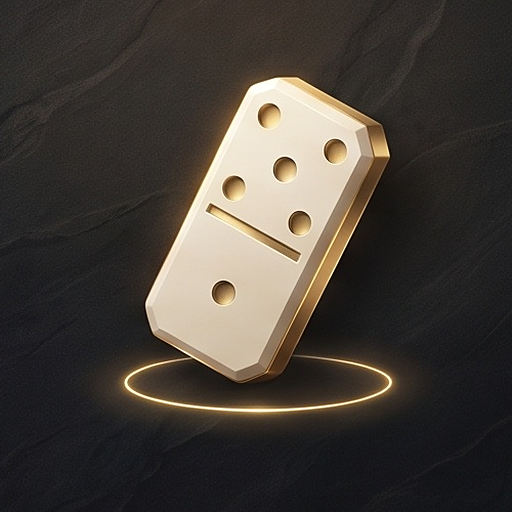

# Atelier Domino

A calm 3D domino toppling studio, built as a single-file PWA (Three.js + cannon-es).

**Open it:** https://johnlaz.github.io/dominos/ then tap *Open the studio*, or install it from the browser menu.

## What it does
- **Featured boards:** six pre-built layouts, including the big Grand Finale and the multi-level Grand Viaduct.
- **Pattern generator:** Switchback, Spiral, Bloom, Fractal Tree, Mandala, Fishbone. Turn on **Combine** to chain 2–3 patterns into one board.
- **Build your own:** drag on the floor to lay a line, start beside a piece to fork a branch.
- **My boards:** save, rename, thumbnail cards, share links.
- **Backup & restore:** Studio → *Backup & app*. Export a `.json` file and restore it later (merges, never deletes).
- **Materials:** Resin & gold, Classic ivory with pips, Beechwood, Rainbow candy and Neon glow (your choice is remembered).
- **Ambient:** Zen loop, cinema mode, optional chimes and haptics (off by default).

## Layout
| Path | What |
|---|---|
| `index.html` | landing page |
| `app/` | the app, manifest, service worker, icons, screenshots |

Saved boards are stored in the browser (localStorage). Use *Back up now* before clearing site data or changing phones.

&copy; LAZLAB Creations
